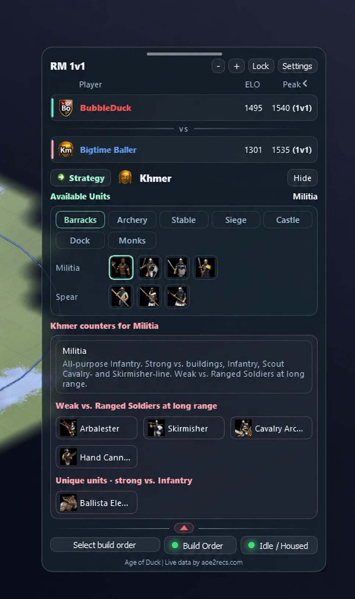

# 🦆 Age of Duck: the AoE2 DE helper overlay

**A free, open-source in-game overlay for Age of Empires II: Definitive Edition.**
Click-for-counter, build-order coaching, Town Centre / housing alerts and live lobby info, in a translucent window that stays out of your way.

[](LICENSE)
[](https://github.com/BubbleDuckz/Age-of-Duck-Mod-AOE2-In-Game-Overlay/releases/latest)

**[Download](https://github.com/BubbleDuckz/Age-of-Duck-Mod-AOE2-In-Game-Overlay/releases/latest)** · **[Website & build-order library](https://ageofduck.com)** · **[Discord](https://discord.gg/hWsa7KS9nw)**

<p align="center">
  
</p>

## Features

- **Click-for-Counter.** Click a player, then a unit, and see what *your* civilisation can build to beat it. Filtered to your tech tree, with your unique units where they're strong. Unit portraits are grouped by upgrade line.
- **Build orders (beta).** Load a build order and the overlay follows your villager count, highlights the current step and reads it out loud. Create and share them at [ageofduck.com/build-orders](https://ageofduck.com/build-orders/).
- **Idle TC / Housed alerts (beta).** Counts your Town Centres and warns you, with a voice, when one is idle, when you're close to the cap, and when you're housed.
- **HUD set-up (beta).** Draw the population, villager, clock and queue areas yourself for any HUD skin, resolution or UI size.
- **Lobby info.** Civ, ELO and peak rating across ladders, colour-coded teams, AI players labelled, and badges for all 56 civilisations.
- **Non-intrusive.** Translucent, draggable and resizable, and it never takes focus from the game.

More screenshots are on the [website](https://ageofduck.com).

## Is it safe?

Age of Duck only **reads pixels on your screen** and public match data. It never sends input to the game and never modifies game files. Permission for automated alerts in ranked play has **not** been verified with Microsoft, so use your own judgement.

## Install

Download `AgeOfDuckInstaller-vX.Y.Z.exe` from the [latest release](https://github.com/BubbleDuckz/Age-of-Duck-Mod-AOE2-In-Game-Overlay/releases/latest). Hashes are in `SHA256SUMS.txt`. The installer isn't code-signed yet, so Windows SmartScreen may warn: choose **More info, then Run anyway**.

Then open Settings, enter your AoE2 profile ID (there's a *Find profile ID* button), and start a match. Run the game in **Windowed or Borderless** mode.

## Run or build from source

Requirements: Windows 10/11 (64-bit) and Python 3.11 or newer.

```bat
git clone https://github.com/BubbleDuckz/Age-of-Duck-Mod-AOE2-In-Game-Overlay
cd Age-of-Duck-Mod-AOE2-In-Game-Overlay
python -m venv .venv
.venv\Scripts\pip install -r requirements.txt
.venv\Scripts\python AgeofDuck.py
```

To build the executable, run `setup_env.bat` once and then `make EXE.bat`. To build the installer, install [Inno Setup](https://jrsoftware.org/isinfo.php) and compile `installer/AgeOfDuckInstaller.iss`. Run a test with, for example, `python -m unittest test_build_orders`. Some tests need large game screenshots or real player data, which aren't included, so those will fail until you supply your own fixtures.

## Project layout

| Path | What it is |
|---|---|
| `AgeofDuck.py` | main overlay application |
| `tc_reminder/` | Town Centre, population, clock and housing detection |
| `build_order*.py`, `build_panel.py` | build-order loading, rules, speech and on-screen panel |
| `hud_*.py`, `villager_reader.py` | HUD regions, calibration and villager reading |
| `recs_provider.py` | live match data |
| `civ_data*.json`, `units_db.json`, `unit_counters*.json`, `techtree_*` | game data used by Click-for-Counter |
| `installer/` | Inno Setup installer script |
| `test_*.py`, `fixtures/` | unit tests and test data |

## Contributing

Pull requests, bug reports and new ideas are welcome. See [CONTRIBUTING.md](CONTRIBUTING.md), or chat in the [Discord](https://discord.gg/hWsa7KS9nw).

## License

The source code is released under the [MIT License](LICENSE). Game artwork and some data included in this repository belong to their owners and are **not** covered by the MIT license: see [NOTICE.md](NOTICE.md).

## Credits & disclaimer

- Tech-tree data: [aoe2techtree.net](https://aoe2techtree.net/) by Siege Engineers (MIT).
- Live match data: [aoe2recs.com](https://aoe2recs.com/).
- Civilisation and unit information derived in part from the [Age of Empires Wiki](https://ageofempires.fandom.com/wiki/Category:Age_of_Empires_II) (CC BY-SA).

Age of Duck is an unofficial fan project, created under Microsoft's [Game Content Usage Rules](https://www.xbox.com/en-US/developers/rules). It is not endorsed by or affiliated with Microsoft, Xbox Game Studios or World's Edge. Age of Empires II © Microsoft Corporation.
